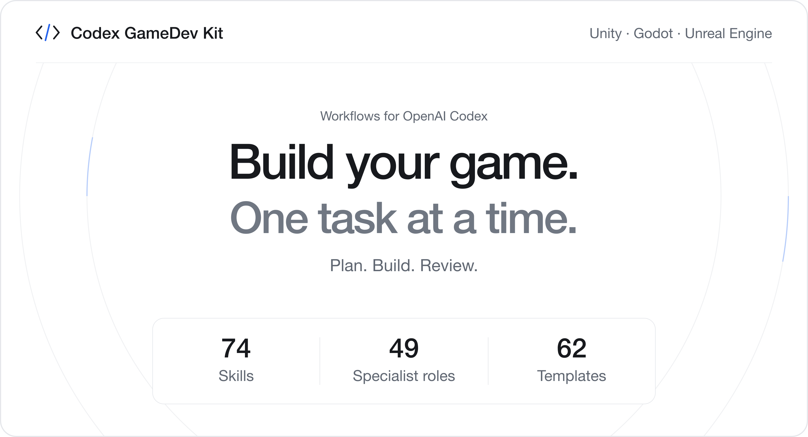
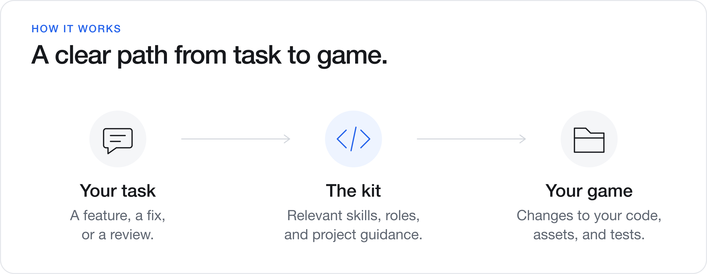
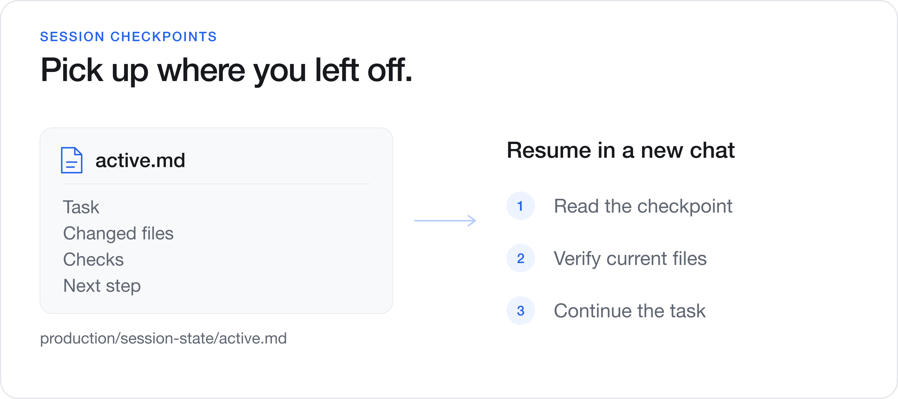

# Codex GameDev Kit

Game development workflows for **OpenAI Codex**, with support for **Unity, Godot, and Unreal Engine**.



[Install](#install) · [Workflows](#workflows) · [Settings](#settings) · [Resume work](#resume-work)

## What's included

| Component | Use |
| --- | --- |
| **74 skills** | Plan features, prototype gameplay, implement stories, review code, and prepare releases. |
| **49 specialist roles** | Get focused guidance for gameplay, UI, AI, networking, art, audio, QA, and engine-specific work. |
| **62 document templates** | Start plans, design notes, reviews, and checklists. |
| **Project instructions** | Keep Codex aligned with your project's architecture and conventions. |
| **Session checkpoints** | Save progress and continue unfinished work in a later chat. |



## Install

### Requirements

- OpenAI Codex.
- Python **3.11+**, Git, and Bash.
- A Unity, Godot, or Unreal Engine project and its engine installation.

On Windows, use **Git Bash or WSL**. Replace `python3` with `python` or `py -3.11` if needed. No Python packages are required.

### 1. Download the kit

```bash
git clone https://github.com/IlyasGameDev/codex-gamedev-kit.git
cd codex-gamedev-kit
python3 tools/studio.py doctor
python3 tools/studio.py validate
```

You can also use **Code → Download ZIP**, extract it, and run the checks from the kit folder.

### 2. Install into your game

Replace the path with your game's root folder. For Unity, use the folder containing `Assets`, `Packages`, and `ProjectSettings`. Replace `unity` with `godot` or `unreal` for those engines.

```bash
python3 tools/studio.py install "/path/to/MyUnityGame" --engine unity --dry-run
python3 tools/studio.py install "/path/to/MyUnityGame" --engine unity
```

The installer preserves game scripts and assets, links the kit from an existing `AGENTS.md`, and stops before writing if kit files conflict. Existing Codex configuration and hooks are kept; `.studio-example` files are provided for merging.

### 3. Open your game in Codex

Open **your game's root folder** in Codex and review its project configuration. From the CLI:

```bash
cd "/path/to/MyUnityGame"
codex
```

For Unity, send this **inside Codex**:

```text
$setup-engine unity
Use the version recorded in ProjectSettings/ProjectVersion.txt.
Keep the existing engine version and project settings.
```

For Godot or Unreal, use `$setup-engine godot` or `$setup-engine unreal`.

Then give Codex a task:

```text
Add a settings popup to my game.
Inspect the UI framework already in use and reuse its components.
Keep the change focused and report what you changed and tested.
```

To enable optional lifecycle checks, review the included hooks through `/hooks` in clients that support them.

### Starting a new game

Create a project in your engine, install the kit into it, then send:

```text
$start I want to make a small farming game.
Define the core loop and the first playable prototype.
```

## Workflows

Describe your task normally or type `$skill-name` **inside Codex**. Use `/skills` to browse.

| Task | Skill |
| --- | --- |
| Find a workflow | `$help` |
| Explore an idea | `$brainstorm` |
| Build a prototype | `$prototype` |
| Plan implementation | `$create-stories` |
| Implement a story | `$dev-story <path-to-story-file>` |
| Review code | `$code-review` |
| Prioritize bugs | `$bug-triage full` |
| Investigate performance | `$perf-profile` |
| Prepare a release | `$release-checklist` |

List the full catalog from the kit or an installed project:

```bash
python3 tools/studio.py catalog
```

### Example prompts

```text
Use $code-review to review Assets/Scripts/PlayerController.cs.
Prioritize bugs and explain the relevant code.
```

```text
Investigate why the pause menu opens twice after I reload the scene.
Find a reproducible cause, apply a focused fix, and verify it.
```

```text
Use $release-checklist mobile for the next Android build.
Report completed checks, remaining tests, and release blockers.
```

## Settings

Use `$settings` to inspect configuration. The default rigor is **minimal**.

| Rigor | Best for |
| --- | --- |
| **Minimal** | Prototypes, solo work, and focused changes. |
| **Standard** | Features that need planning, shared documentation, and QA records. |
| **Full** | Larger projects with detailed design records and broader reviews. |

Change the rigor inside Codex:

```text
$settings modes.rigor=standard
```

Project settings live in `project.yaml`; personal overrides use the Git-ignored `project.local.yaml`.

## Resume work



Before leaving unfinished work, ask Codex:

```text
Update production/session-state/active.md with the current task,
changed files, decisions, checks, blockers, and next step.
Keep it concise.
```

In a later chat in the same project:

```text
Read production/session-state/active.md, verify the relevant current files,
and continue from the next step.
```

Checkpoints are local and ignored by Git. Copy them separately when moving to a fresh clone.

---

[MIT license](LICENSE)
